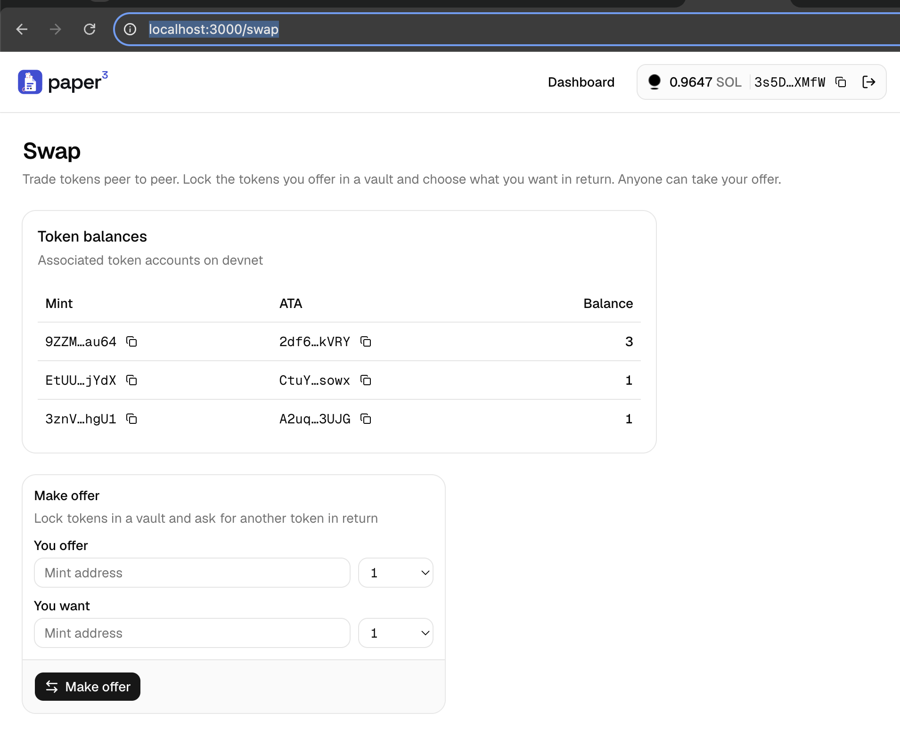
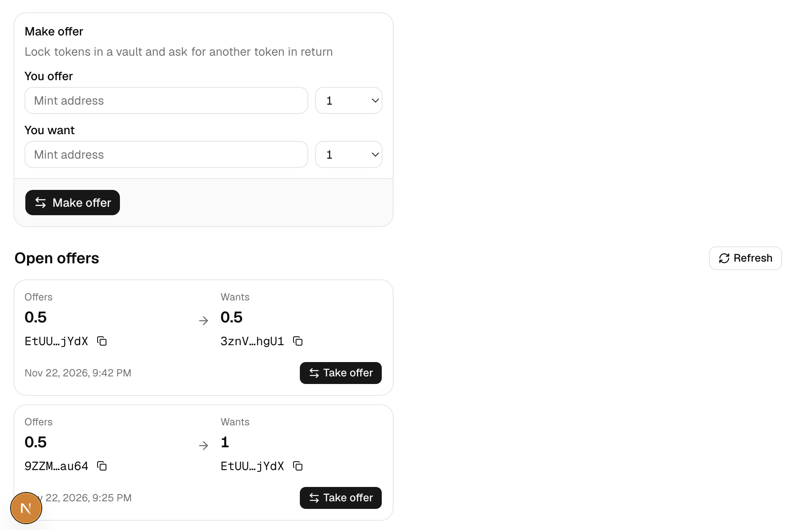

# Paper3 — Swap

Paper3 is a dapp on **Solana devnet** (Solana's free test network) for tokenizing intellectual property. This README covers only the **Swap** page: [http://localhost:3000/swap](http://localhost:3000/swap).

## Chosen route

**Guided project:** the swap (escrow) program from the WayLearn course, plus a frontend built for it in this repo.

- Contracts repository: [fsDapp2-svm-contracts-reloaded/programs/swap](https://github.com/cnerylozada/fsDapp2-svm-contracts-reloaded/tree/develop/programs/swap)
- Program address (devnet): `uEd5zro44qqnFg67EAYxZ6uYYVFhg5Hkdvkx4mo7RQE`

> ✅ **Fully tested with [LiteSVM](https://github.com/LiteSVM/litesvm).** The swap program has a complete test suite that runs on LiteSVM, a fast in-process Solana VM. The tests are in the contracts repository.

## Purpose

Two people trade tokens directly, with no intermediary. The program holds the tokens in escrow until the trade happens:

1. **Make an offer.** A **maker** chooses the token and amount they give and the token and amount they want in return. The tokens they give are locked in a **vault**, a token account owned by the program, so nobody can move them except through the swap.
2. **Take the offer.** Anyone else (a **taker**) can accept it. In a single transaction the taker sends the wanted tokens to the maker and receives the tokens from the vault. If any part fails, nothing moves. The offer is then closed and disappears from the list.

### What the page shows

- **Token balances**: how many of each test token your wallet holds.
- **Make offer**: the form to create an offer.
- **Open offers**: one card for every offer on-chain. Each card shows what is offered, what is wanted, when it was created, and a **Take offer** button. The offers are listed in descending order by creation date (`created_at`), so the newest comes first.





### Things to know

- **Classic tokens only.** The swap works with **any classic SPL Token mint**, but not with Token-2022 mints. A **mint** is the address that identifies a token type.
- **9 decimals.** The UI assumes every mint has 9 decimals. With a different number of decimals, the amounts shown would be wrong.
- **Fixed amounts.** In **Make offer**, amounts are picked from a list (0.5, 1, 1.5, 2, 2.5) instead of typed.
- **Test tokens.** **Token balances** only lists these three test mints (hardcoded in `components/dashboard/TokenBalances.tsx`):

  - `9ZZMtJ9y5mES7P4bgBUa3pcgpNzqwaw4pPLzn8Ghau64`
  - `EtUUV91XJKe4VthcQCb1RBAiDBepMVnXg57hSyKJjYdX`
  - `3znVbWWQcDPxhUNoZcMd3fQSDarCLwXqtAUut2GPhgU1`

  If you want free tokens of these mints to test the swap, feel free to get in touch with me ([cnerylozada on GitHub](https://github.com/cnerylozada) or by phone at +51 974 822 213).

## Setup

Requirements:

- Node.js 20 or newer.
- A Google account to log in. Two accounts if you want to test both sides of a trade.

1. Install the dependencies:

   ```bash
   npm install
   ```

2. Create a file named `.env` in the project root (next to `package.json`) with this line:

   ```bash
   NEXT_PUBLIC_PRIVY_APP_ID=cmw9ibnbb004e0hl8nr2q399t
   ```

   This is the ID of the [Privy](https://privy.io) app that handles the Google login. It is shared temporarily for the review and only works on `http://localhost:3000`. To use your own, create an app in the [Privy dashboard](https://dashboard.privy.io) with Google login and Solana embedded wallets enabled.

## Running

```bash
npm run dev     # starts the app on http://localhost:3000
```

Other commands:

```bash
npm run build   # production build
npm run lint    # check the code with eslint
```

If the program changes, copy its new Anchor IDL to `lib/programs/swap/idl.json` and regenerate the TypeScript client:

```bash
npx codama run js --config lib/programs/swap/codama.json
```

## Own contribution

The program comes from the course. Everything in this repo, the frontend that talks to it, is my own work:

- **Typed client:** the program's TypeScript client is generated from the Anchor IDL with Codama (`lib/programs/swap/generated/`). It is registered as a plugin on the Solana Kit client (`client.swap`). Each instruction then works out its own derived accounts (the offer, the vault and the token accounts), so the UI only passes the mints, amounts and wallets.
- **Google login, no extension:** users sign in with Google through Privy, which creates a Solana wallet for them automatically. Transactions are built with Solana Kit and signed and sent by Privy, so there's no wallet extension like Phantom to install.
- **Make offer** (`components/swap/MakeOffer.tsx`):
  - The form checks that both mint addresses are valid before sending (`react-hook-form` + `zod`).
  - The chosen amounts are converted to the token's smallest units (9 decimals).
  - Each offer gets an id from a UUID converted to 16 bytes. This simulates the id a database row (Supabase) would give it later.
- **Open offers** (`components/swap/OfferList.tsx`, `components/swap/OfferCard.tsx`):
  - Every offer account is read from the chain with `getProgramAccounts` and decoded with the generated client.
  - Each offer is a card with both amounts and mints (with a copy button) and the creation date, newest first.
- **Take offer:** the button on each card sends the `take_offer` instruction. A link to the transaction in Solana Explorer appears, and the list reloads without the taken offer.
- **Protected route:** visiting `/swap` without being logged in redirects to `/login` (`proxy.ts`).

## How to test it

You need two Google accounts, one for the **maker** and one for the **taker**. Using two browsers (or a normal and a private window) lets you stay logged in with both at once.

1. **Open the page.** Run `npm run dev`, open [http://localhost:3000](http://localhost:3000) and log in with Google. After logging in, go to [http://localhost:3000/swap](http://localhost:3000/swap) to start the flow.
2. **Get devnet SOL.** Every transaction pays a small fee in SOL. Copy your wallet address with the copy button in the header, then request free devnet SOL at [faucet.solana.com](https://faucet.solana.com). Repeat for the second account.
3. **Get test tokens.** Ask me for tokens of the test mints (see [Things to know](#things-to-know)), or use your own classic SPL mints with 9 decimals (for example created with `spl-token create-token` and `spl-token mint`). Check the **Token balances** card:
   - The **maker** needs a balance of the token they will offer.
   - The **taker** must already hold the token the maker wants, at least the wanted amount. The program does not create that token account for them.
4. **Make an offer (maker).** In **Make offer**:
   - Paste the mint you give in **You offer** and pick an amount.
   - Paste the mint you want in **You want** and pick an amount.
   - Click **Make offer** and wait for the green success message. Its link opens the transaction in Solana Explorer.
   - Click **Refresh** in **Open offers**. Your offer appears at the top.
5. **Take the offer (taker).** Log in with the second account, open `/swap`, then click **Take offer** on that card. When it confirms, a success message with the Explorer link appears and the offer disappears from the list.
6. **Check the result.** Reload the page with each account. **Token balances** shows that the maker received the wanted tokens and the taker received the offered ones.

If a transaction fails, the error appears in a red box above the form or the list. Common causes: no devnet SOL, not enough tokens, or the taker has never held the wanted token.
